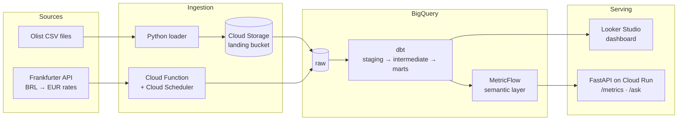

# Retail Analytics Platform

End-to-end analytics platform on Google Cloud, built on the public [Olist](https://www.kaggle.com/datasets/olistbr/brazilian-ecommerce) e-commerce dataset: infrastructure as code, idempotent ingestion, a dimensional model in dbt, governed metrics, and an AI layer that answers business questions through those metrics.

> **Status: in progress.** Started in October 2026; sections marked "planned" are being built.

## Why this project

Most dbt portfolio projects stop at a handful of models on toy data. This one covers the whole job of an analytics engineer: from raw files to trusted KPIs that a business user, or an AI agent, can query without getting a wrong number.

Every significant design choice is written down in [`docs/decisions/`](docs/decisions/), with the context, the options considered and the trade-offs.

## Architecture



Terraform provisions every GCP resource, GitHub Actions tests and deploys every change, and Airflow runs the daily pipeline.

## Stack

| Layer | Tools |
| --- | --- |
| Infrastructure | Terraform (dev and prod environments, remote state, keyless auth with Workload Identity Federation) |
| Ingestion | Python, Cloud Functions, Cloud Scheduler, Cloud Storage |
| Warehouse | BigQuery (partitioning, clustering, cost tracking per model) |
| Transformation | dbt Core |
| Data quality | dbt tests, unit tests, model contracts, Elementary |
| Semantic layer | dbt Semantic Layer / MetricFlow |
| Orchestration | Airflow (Astro CLI, astronomer-cosmos) |
| CI/CD | GitHub Actions, sqlfluff, pre-commit, dbt-project-evaluator |
| Serving | FastAPI on Cloud Run, Gemini, Looker Studio |

## Data

- **Olist Brazilian E-Commerce**: about 100k orders placed between 2016 and 2018, across 9 tables (orders, items, payments, reviews, customers, sellers, products, geolocation, category translations). Published on Kaggle under the CC BY-NC-SA 4.0 license. The raw files are not committed to this repository; see [Getting started](#getting-started).
- **Daily exchange rates BRL → EUR** from the [Frankfurter API](https://www.frankfurter.app) (European Central Bank reference rates), used to report revenue in euros at the rate of the order date.

## Data model (planned)

| Model | Grain: one row per… |
| --- | --- |
| `fct_order_items` | order item |
| `fct_orders` | order |
| `fct_deliveries` | order, from purchase to delivery (accumulating snapshot) |
| `fct_reviews` | customer review |
| `dim_customers` | customer |
| `dim_sellers` | seller |
| `dim_products` | product, with category history (SCD type 2) |
| `dim_date` | calendar day |

The full bus matrix will live in [`docs/bus_matrix.md`](docs/) and every KPI definition in [`docs/glossary.md`](docs/).

## KPIs

Net revenue (EUR) · average basket · orders · items per order · cancellation rate · actual vs promised delivery time · late delivery rate · average review score · share of 1–2 star reviews · shipping cost as a share of revenue.

Ratios are never stored pre-aggregated: the marts keep additive components and the semantic layer computes ratios at query time, so they stay correct at every level of detail.

## Repository structure (planned)

```
infra/           Terraform modules and environments (dev, prod)
ingestion/       Python loaders and the exchange-rate Cloud Function
dbt/             dbt project: staging, intermediate, marts, semantic models
api/             FastAPI service (/metrics, /ask)
orchestration/   Airflow DAGs
docs/            bus matrix, KPI glossary, decision records
```

## Getting started

Prerequisites: Python 3.11+, [uv](https://docs.astral.sh/uv/), Terraform, the gcloud CLI, Docker, and a GCP project with billing enabled.

```bash
git clone https://github.com/<your-username>/retail-analytics-platform.git
cd retail-analytics-platform
uv sync
gcloud auth application-default login
```

Step-by-step instructions for each layer (infrastructure, ingestion, dbt, API) will be added as each one lands.

## Key results

Filled in as the project progresses.

| Measure | Result |
| --- | --- |
| Full rebuild from scratch (Terraform + ingestion + dbt) | — |
| Bytes scanned saved by partitioning and clustering | — |
| `/ask` accuracy on the 20-question evaluation set | — |
| Tests run on every pull request | — |

## Author

**Ilyes Ameur**, Analytics Engineer · [LinkedIn](https://www.linkedin.com/in/ilyes-ameur-552655315)

## License

Code released under the MIT License. The Olist dataset remains under its own license (CC BY-NC-SA 4.0).
