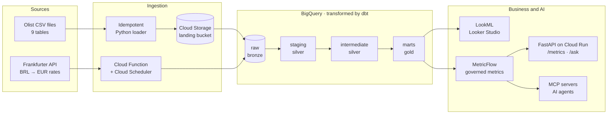

# Retail Analytics Platform

End-to-end analytics platform on Google Cloud, built on the public [Olist](https://www.kaggle.com/datasets/olistbr/brazilian-ecommerce) e-commerce dataset: infrastructure as code, idempotent ingestion, a dimensional model in dbt, governed metrics, and an AI layer that answers business questions through those metrics.

> **Status: in progress.** Started in October 2026 and built in weekly increments, one merged pull request per sprint. Sections marked *planned* are being built; progress is tracked in the [roadmap](#roadmap).

## Why this project

Most dbt portfolio projects stop at a handful of models on toy data. This one covers the whole job of an analytics engineer: from raw files to trusted KPIs that a business user, or an AI agent, can query without getting a wrong number.

Every significant design choice is written down in [`docs/decisions/`](docs/decisions/), with the context, the options considered and the trade-offs.

## Architecture



Only the gold marts are exposed to business users and AI agents. Terraform provisions every GCP resource, GitHub Actions tests and deploys every change, Airflow runs the daily pipeline, Elementary monitors data quality, and secrets live in Secret Manager.

## Stack

| Layer | Tools |
| --- | --- |
| Infrastructure | Terraform (modules, dev and prod environments, remote state), keyless CI auth with Workload Identity Federation, Secret Manager |
| Ingestion | Python, Cloud Storage, Cloud Functions, Cloud Scheduler |
| Warehouse | BigQuery (partitioning, clustering, cost tracking per model, policy tags, row-level security) |
| Transformation | dbt Core (incremental models, snapshots, macros, contracts, model versions) |
| Data quality | dbt data tests and unit tests, dbt_expectations, Elementary |
| Semantic layer and BI | MetricFlow, LookML, Looker Studio |
| Orchestration | Airflow (Astro CLI, astronomer-cosmos) |
| CI/CD | GitHub Actions, sqlfluff, pre-commit, dbt-project-evaluator |
| Serving and AI | FastAPI on Cloud Run, Gemini, dbt MCP server, MCP Toolbox, BigQuery AI functions |

## Data

- **Olist Brazilian E-Commerce**: about 100k orders placed between 2016 and 2018, across 9 tables (orders, items, payments, reviews, customers, sellers, products, geolocation, category translations). Published on Kaggle under the CC BY-NC-SA 4.0 license. The raw files are not committed to this repository; see [Getting started](#getting-started).
- **Daily exchange rates BRL → EUR** from the [Frankfurter API](https://www.frankfurter.app/) (European Central Bank reference rates), used to report revenue in euros at the rate of the order date.

Each source table's grain, keys, relationships and known anomalies are documented in [`docs/sources.md`](docs/sources.md).

## Data model *(planned)*

| Model | Grain: one row per… |
| --- | --- |
| `fct_order_items` | order item (incremental) |
| `fct_orders` | order |
| `fct_payments` | payment line (payment type, number of installments) |
| `fct_deliveries` | order, from purchase to delivery (accumulating snapshot) |
| `fct_reviews` | customer review |
| `dim_customers` | customer |
| `dim_sellers` | seller |
| `dim_products` | product, with category history from a type 2 snapshot |
| `dim_geography` | zip code prefix |
| `dim_date` | calendar day |
| `mart_kpi_daily` | day and dimension, additive KPI components only |

The full bus matrix lives in `docs/bus_matrix.md` and every KPI definition in `docs/glossary.md`.

## KPIs

Net revenue (EUR) · average basket · orders · items per order · cancellation rate · actual vs promised delivery time · late delivery rate · average review score · share of 1–2 star reviews · shipping cost as a share of revenue · share of orders paid in installments · average basket by number of installments.

Ratios are never stored pre-aggregated: the marts keep additive components and the semantic layer computes ratios at query time, so they stay correct at every level of detail.

## Repository structure *(planned)*

```
infra/           Terraform modules and environments (dev, prod)
ingestion/       Python loaders and the exchange-rate Cloud Function
dbt/             dbt project: staging, intermediate, marts, snapshots, semantic models
lookml/          LookML views and explores on the marts
api/             FastAPI service (/metrics, /ask)
orchestration/   Airflow DAGs
docs/            sources, conventions, bus matrix, glossary, contracts, incidents, decisions
```

## Getting started

Prerequisites: Python 3.12, [uv](https://docs.astral.sh/uv/), Terraform, the gcloud CLI, Docker, and a GCP project with billing enabled. On Windows, everything runs inside WSL2.

```bash
git clone https://github.com/<your-username>/retail-analytics-platform.git
cd retail-analytics-platform
uv sync
gcloud auth application-default login
```

Step-by-step instructions for each layer (infrastructure, ingestion, dbt, API) will be added as each one lands.

## Key results

Filled in as the project progresses.

| Measure | Result |
| --- | --- |
| Full rebuild from scratch (Terraform + ingestion + dbt) | — |
| 30 replayed days vs full refresh | — |
| Bytes scanned saved by partitioning and clustering | — |
| `/ask` accuracy on the 20-question evaluation set | — |
| Semantic layer vs text-to-SQL accuracy | — |
| Tests run on every pull request | — |

## Roadmap

- [ ] **Foundations** — tooling, source profiling and business questions, Terraform foundation, idempotent ingestion
- [ ] **Modeling** — dbt staging, bus matrix and star schema, KPI specifications, macros, glossary
- [ ] **Reliability** — incremental models, late-arriving data, type 2 snapshots, tests, contracts, Elementary, incident drill
- [ ] **Production** — CI/CD with state-based builds, governance and access control, GDPR erasure, BigQuery cost optimization
- [ ] **Serving** — MetricFlow and LookML, metrics API on Cloud Run, reverse ETL export, Airflow orchestration
- [ ] **AI** — natural-language questions over governed metrics, dbt MCP server, hosted MCP Toolbox, evaluation

## Author

**Ilyes Ameur**, Analytics Engineer · [LinkedIn](https://www.linkedin.com/in/<your-profile>)

## License

Code released under the MIT License. The Olist dataset remains under its own license (CC BY-NC-SA 4.0).
